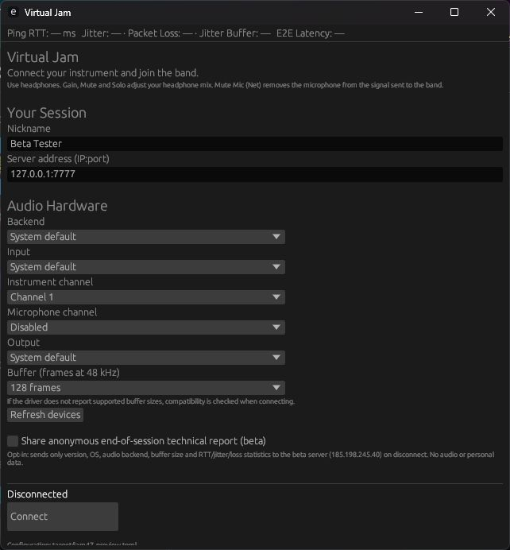

# Virtual Jam — Real-Time Virtual Rehearsal Room in Rust

## Quick Start for Beta Testers

Virtual Jam lets up to **8 musicians** rehearse together remotely, with live audio,
a personal headphone mix, and a shared metronome. It is free, open-source beta software.
Low latency depends on your audio hardware, connection, and distance to other musicians;
the engineering target is below 20–25 ms, not a guaranteed result.

[Download a beta](https://github.com/mielecarmine/Virtual-Jam-Hub/releases) ·
[Send beta feedback](https://github.com/mielecarmine/Virtual-Jam-Hub/issues/new?template=beta_feedback.md) ·
[Interface preview](#interface-preview)

### 1. Download and install

Use **GitHub Releases**, including pre-releases (the `/releases/latest` shortcut can
skip betas). The **1.0.6-beta** release provides these downloads once published:

| System | Download / availability | Installation and requirements |
| --- | --- | --- |
| Windows x64 | [Download `.exe` (1.0.6-beta)](https://github.com/mielecarmine/Virtual-Jam-Hub/releases/download/1.0.6-beta/Virtual-Jam-1.0.6-beta-windows-x64-setup.exe) | Windows 10/11; run the installer, then open **Virtual Jam** from Start. Per-user installation. |
| macOS Apple Silicon | [Download `.pkg` (1.0.6-beta)](https://github.com/mielecarmine/Virtual-Jam-Hub/releases/download/1.0.6-beta/Virtual-Jam-1.0.6-beta-macos-arm64.pkg) | macOS 11+ on ARM64; open the package, launch **Virtual Jam** from Applications, and allow microphone access. |
| Linux x64 client | [Download `.deb` (1.0.6-beta)](https://github.com/mielecarmine/Virtual-Jam-Hub/releases/download/1.0.6-beta/Virtual-Jam-1.0.6-beta-linux-amd64.deb) | Ubuntu 22.04+ / compatible Debian-based x86_64 system (glibc 2.35+). Install with `sudo apt install ./Virtual-Jam-1.0.6-beta-linux-amd64.deb`; launch **Virtual Jam** or `virtual-jam`. |
| Linux x64 standalone server | [Download `.tar.gz` (1.0.6-beta)](https://github.com/mielecarmine/Virtual-Jam-Hub/releases/download/1.0.6-beta/Virtual-Jam-Server-1.0.6-beta-linux-amd64.tar.gz) | Linux x86_64, glibc 2.35+; no audio hardware required. See [server setup](deploy/README.md). |

**1.0.6-beta** includes the English interface (JAM-45) and Linux packaging (JAM-46).
If its downloads are not available yet, check [Releases](https://github.com/mielecarmine/Virtual-Jam-Hub/releases)
for the published betas or [build from source](CONTRIBUTING.md#3-build-prerequisites).
Client and server must use compatible builds; update the whole room together.

**Unsigned beta:** these installers have no commercial Windows/Apple code signing or
Apple notarization. SmartScreen or Gatekeeper may ask for explicit approval. Only approve
an installer you trust from this repository's Releases page; do not disable system-wide
protections. The macOS ad-hoc signature does not certify the author's identity.
Check downloaded files against the release's `SHA256SUMS.txt`.

### 2. Prepare your audio hardware

- **Wired headphones are required.** Avoid speakers (acoustic feedback) and Bluetooth
  headphones (latency can exceed 100 ms).
- Use an audio interface with input and output at **48 kHz**. Start with **128 frames**;
  try **64** for lower latency or **256** if you hear clicks, when supported by the driver.
- Windows: install the interface manufacturer's **ASIO** driver for low latency;
  **WASAPI** is also available. macOS: **CoreAudio**. Linux: **ALSA**, including
  PipeWire through ALSA `default` / `pipewire` devices.
- Connect your instrument, choose its **Instrument channel**, and optionally select a
  separate **Microphone channel** for talkback. Leave the microphone disabled if unused.
  If you use the app's local monitoring, disable hardware direct monitoring to avoid
  hearing your input twice.

### 3. Join a room or host a test

**Shared server:** obtain a compatible server's **IP address and UDP port** from your
test organizer. There is no guaranteed public test room. Open **Virtual Jam**, enter
your **Nickname** and **Server address (IP:port)** (for example `192.168.1.10:7777` on
a LAN, or `[IPv6]:7777`), choose **Backend**, **Input**, **Output** and **Buffer**, then
click **Connect**. Ask another musician to join the same server: you hear remote peers
and your locally monitored input. One server hosts one room of at most **8 musicians**.

**LAN / self-hosted server:** on a Linux host, extract the standalone archive and
run `./jam-server`. Alternatively, from a source checkout with
[build prerequisites](CONTRIBUTING.md#3-build-prerequisites):

```sh
cargo run --locked --release -p jam-server
```

Keep the server running and enter its LAN IP in every client's server field. Use
`127.0.0.1:7777` only when client and server run on the same computer. The server listens
on **UDP 7777** by default; allow that UDP port in the host firewall and, for a VPS,
the provider's firewall. For a server behind a home router, remote access also requires
UDP port forwarding. See [Linux deployment](deploy/README.md) for a persistent service.
P2P routes are negotiated automatically; the SFU server is still needed to join the room
and provides relay fallback.

**Beta security:** audio/control traffic has **no encryption or authentication**.
Use trusted participants and a trusted LAN or VPN. An exposed server address does not
provide a private or access-controlled room.

**Local test without a server:** with wired headphones, run a 30-second hardware loopback
from a source checkout:

```sh
cargo run --locked --release -p jam-client -- --seconds 30
```

Or run the installed client with `--seconds 30`: on Linux, `virtual-jam --seconds 30`;
on Windows PowerShell,
`& "$env:LOCALAPPDATA\Programs\Virtual Jam\jam-client.exe" --seconds 30`;
on macOS, `"/Applications/Virtual Jam.app/Contents/MacOS/jam-client" --seconds 30`.
This plays your input into your headphones without using the network. It uses the system
default devices and 128 frames at 48 kHz; CLI device options are described in
[Local Hardware Audio Loopback](#7-local-hardware-audio-loopback--jam-8).

### 4. Help improve the beta

Use the [Beta feedback issue template](https://github.com/mielecarmine/Virtual-Jam-Hub/issues/new?template=beta_feedback.md)
to report what worked, clicks/dropouts, connection problems, or unexpected latency.
Include app/server versions, OS, backend, interface, buffer, number of musicians,
P2P/SFU routes and the displayed **E2E Latency**. That value is a one-way **estimate**;
it does not measure remote hardware or replace an external latency measurement.

Sharing diagnostics is optional:

- **Remote report (off by default):** before connecting, select
  **Share anonymous end-of-session technical report (beta)** to send aggregate technical
  metrics on disconnect. It sends no audio or nicknames. See the
  [privacy notice](#privacy--telemetry-notice) for report contents and source-IP handling.
- **Manual feedback:** pre-release installers write a local `telemetry-*.txt` file during
  GUI sessions, next to `client.toml`. The GUI shows that path under **Configuration:**.
  Disconnect to finish the log, then attach it to the issue or paste relevant summary
  lines. Source builds need `--features jam-client/telemetry-log` to enable these local
  logs. Local files remain on your device unless you share them; review anything you
  attach to a public issue and remove private details or credentials.

### Interface preview



*Actual Windows setup screen from the active pre-release branch. No session is running;
the mixer and metronome appear after connecting. Older published betas may differ.*

| Area in the connected interface | What to look for |
| --- | --- |
| **Your Headphone Mix** | Multi-channel mixer with a VU/peak meter, dB gain, **M · Mute**, and **S · Solo** for each musician, plus **Local Instrument** and optional **Local Microphone**. These controls change your headphone mix; **Mute Mic (Net)** silences outgoing talkback. |
| Route indicators | The telemetry bar shows `Peer N: P2P` or `Peer N: SFU` for each remote musician. Mixed routes can coexist; no manual mode selection is needed. |
| **E2E Latency** | Estimated one-way budget: **Optimal** below 20 ms, **Borderline** at 20–25 ms, **Tempo-Drag Risk** above 25 ms. Hover for the breakdown; `—` means an estimate is unavailable. |
| **Metronome & Tempo-Drag Prevention** | **Room Metronome On/Off**, **BPM**, beats per bar, and **Reference / Tempo Leader**. Room controls are shared; click volume and mute are local. |

For engineering details, building, and protocol documentation, continue below or read
[CONTRIBUTING.md](CONTRIBUTING.md).

<!-- Release maintenance: when 1.0.6-beta is published, replace the download table with
direct links to all four assets from that release and its SHA256SUMS.txt. Asset names:
Virtual-Jam-VERSION-windows-x64-setup.exe, Virtual-Jam-VERSION-macos-arm64.pkg,
Virtual-Jam-VERSION-linux-amd64.deb, Virtual-Jam-Server-VERSION-linux-amd64.tar.gz.
Verify against the published release, not just the workflow artifacts. Refresh the setup
screenshot when GUI labels change; add a connected-session screenshot showing the mixer,
route indicators and metronome, using test nicknames and no private endpoints. -->

## Technical Documentation

### 1. System Architecture

The project is organized as a Monorepo (Cargo Workspace) composed of 4 crates implementing a centralized Client-Server SFU (Selective Forwarding Unit) architecture over UDP (with hybrid direct P2P routes and optional beta log collection):

```text
virtual-jam/
├── Cargo.toml # Workspace root (resolver = "2")
└── crates/
    ├── jam-protocol/  # Shared library: binary packet structs, constants, zero-copy serialization
    ├── jam-server/    # Headless binary (Linux systemd): UDP Packet Reflector (1 -> N-1) and SessionTable
    ├── jam-client/    # Desktop binary: RT audio engine (cpal), Jitter Buffer, DSP Mixer, Opus, and GUI (egui)
    └── jam-collector/ # Optional HTTP collector for centralized beta logs and anonymous telemetry reports
```

#### Data Flow

- **Capture (`jam-client`):** The audio callback captures blocks of 128 samples at 48 kHz (~2.66 ms), pushes them into a lock-free ring buffer toward the network thread, compresses them with Opus (`LowDelay`), and sends them over UDP to the server (or directly to peers over P2P).
- **Forwarding (`jam-server`):** The VPS daemon validates the 12-byte binary header and immediately forwards the raw packet to all other N-1 connected peers without decoding the audio (internal processing `< 0.2 ms`).
- **Playback (`jam-client`):** The client receives separate streams per `peer_id`, reorders packets via an independent adaptive Jitter Buffer per peer, decodes Opus (with Packet Loss Concealment), applies gain/mute/solo, and sums channels with soft-clipping before sending them to the audio interface.

### 2. Critical Engineering Rules (AI Agent Guardrails)

Every code change produced by developers or AI agents must strictly obey the following constraints:

- **Zero-Allocation & Lock-Free on the Audio Thread (`cpal`):**
  - Inside `cpal` input and output callbacks, it is strictly forbidden to allocate heap memory (`Box`, `Vec`, `String`, `format!`), acquire `Mutex` or `RwLock`, or perform syscalls or network/disk I/O.
  - Communication between the Audio Thread, Network Thread, and UI Thread must happen exclusively via lock-free SPSC ring buffers (`rtrb`) or atomic types (`AtomicU32` for `f32::to_bits()`, `AtomicBool`).
- **UDP Only, Zero TCP:**
  - Never introduce TCP sockets for real-time audio streaming or control to avoid Head-of-Line Blocking. Packet loss and reordering are handled at the application layer via `sequence_number` and Opus PLC.
- **Zero-Copy Binary Protocol:**
  - Do not use JSON, MessagePack, or text formats in real-time network packets. Use fixed binary layouts (`#[repr(C)]`) with explicit endianness (`to_le_bytes` / `from_le_bytes`) and total packet size always below 1400 bytes (below MTU).
- **Per-Peer Isolation:**
  - Never mix packets from different musicians in the same Jitter Buffer. Each `peer_id` has distinct latency and jitter and requires its own reorder queue and its own Opus decoder instance.
- **Local Direct Monitoring:**
  - The client never receives its own audio stream back from the server to avoid delayed echo.

### 3. Technology Stack & Core Crates

- **Hardware Audio I/O:** `cpal` (48 kHz, `f32`, fixed buffer sizes 64/128/256 samples)
- **Real-Time Concurrency:** `rtrb` (wait-free SPSC ring buffer), `std::sync::atomic`
- **Networking:** `std::net::UdpSocket` (non-blocking)
- **Audio Codec:** `opus` (`Application::LowDelay`, 2.5 ms / 5 ms frames)
- **GUI:** `eframe` / `egui`

### 4. Development Roadmap (Epics)

- **EPIC 1 — Foundation & Protocol (`jam-protocol`):** Workspace setup, audio header (12 B), control messages (`JoinRequest`, `JoinAccepted`, `PeerListUpdate`, `Ping`/`Pong`), and round-trip unit tests.
- **EPIC 2 — VPS SFU Service (`jam-server`):** Non-blocking UDP socket, `SessionTable` with 5 s watchdog timeout, `1 -> N-1` forwarding, local 5-bot stress test, and Linux systemd deployment.
- **EPIC 3 — Audio & Network Engine (`jam-client` CLI):** Hardware loopback `cpal` + `rtrb`, Opus streaming over UDP, per-peer Jitter Buffer with packet loss/jitter simulator, RT mixer with soft-clipping, and Opus integration.
- **EPIC 4 — Graphical Interface & UX (`jam-client` GUI):** Audio device setup in `egui`, dynamic channel strips (dB fader, Mute, Solo), and live telemetry (VU meter, Ping RTT, Jitter, Packet Loss).

### 5. Useful Commands

```bash
# Build the entire workspace
cargo build --workspace

# Optimized release build for latency testing and VPS deployment
cargo build --release --workspace

# Run unit and integration tests
cargo test --workspace

# Strict code quality and formatting checks
cargo clippy --workspace -- -D warnings
cargo fmt --check
```

### Audio Header and Streams

`AudioHeader` maintains 12 bytes and 4-byte C alignment. The wire format uses little-endian:

| Offset | Field | Bytes |
| --- | --- | --- |
| 0 | `magic` | 2 |
| 2 | `packet_type` | 1 |
| 3 | `peer_id` | 1 |
| 4 | `sequence_number` | 4 |
| 8 | `timestamp_samples` | 2 |
| 10 | `stream_id` | 1 |
| 11 | `reserved` | 1 |

`AudioHeader::new(peer_id, stream_id, sequence_number, timestamp_samples)` initializes
`reserved` to zero. `STREAM_PRIMARY = 0` identifies the primary instrument and
`STREAM_TALKBACK = 1` identifies voice; remaining stream IDs are reserved for future use.
Sequence numbers and timestamps advance with `wrapping_add`, modulo 2^32 and 2^16 respectively.
Serialization operates directly on slices with zero allocations, even on unaligned input.
The server forwards all streams unchanged.

This layout replaces the earlier 32-bit timestamp: client and server must use the same
protocol version, as the legacy format is incompatible.

### 6. Starting the UDP Server

To install the service on Linux with systemd and verify handshake/Pong from a home
network, follow [deploy/README.md](deploy/README.md).

```bash
cargo run -p jam-server --release
```

The server listens on `0.0.0.0:7777` over UDP. A 100 ms receive timeout allows the
watchdog to check sessions even when there is no traffic. Each room accepts up to 8
endpoints, assigning the lowest free ID between 1 and 8. A repeated `JoinRequest` from
the same endpoint keeps its ID and updates its nickname. On join, `Leave`, or session
timeout, all remaining peers receive a `PeerListUpdate` sorted by ID.

Clients must send valid audio packets with their own ID or `Ping` messages to keep the
session alive; `Ping` receives a `Pong`. After more than 5 seconds of inactivity, the
server removes the peer and frees its ID. Malformed datagrams, packets of 1400 bytes or
more, or packets whose ID does not match the endpoint do not renew the session. When the
room is full, new join attempts are ignored: the current protocol does not define a
rejection message.

Every valid audio packet is forwarded unchanged (header and payload) to all other active
peers. The sender never receives its own audio. The ID in the header must match the ID
assigned to the UDP endpoint: packets with spoofed IDs are dropped without refreshing
the watchdog.

Server tests use local UDP sockets on ephemeral ports:

```bash
cargo test -p jam-server
```

The suite includes the stress test `tests/load_test.rs`: five bot threads complete the
join on a local server using an ephemeral port and each sends 4,000 datagrams of 120 bytes,
one every 2.5 ms, for 10 seconds. Total load is 2,000 packets/s inbound and 8,000 packets/s
outbound. Each bot must receive at least 99.9% of the 16,000 packets from the other four,
with no duplicates, per-sender reordering, or local echo. The test also verifies headers
and payloads and waits a final 300 ms to drain in-flight datagrams. It runs as part of
the standard test suite. To view per-bot counts:

```bash
cargo test -p jam-server --test load_test -- --nocapture
```

The latency gate is run separately in release mode on an idle machine: it verifies 500
frames with 5 active peers and requires a maximum below 200 µs. Timing with `Instant`
starts immediately after `recv_from` and ends after the last `send_to` attempt, including
validation and watchdog checks; it excludes network wait time.
`Server::last_reflection_duration()` exposes this duration for the latest audio poll.

```bash
cargo test --release -p jam-server --test udp_reflector five_peer_forwarding_stays_below_200_microseconds -- --ignored --nocapture
```

### 7. Local Hardware Audio Loopback — JAM-8

The CLI client connects audio input to local output without a server or network:

```text
cpal input -> mic_to_net -> thread local-loopback -> net_to_speaker -> cpal output
```

Input and output devices must support 48,000 Hz and a fixed buffer of **128 frames per
channel** (~2.67 ms). The requested buffer size does not dictate the exact length of every
callback: ALSA may deliver shorter or coalesced periods. The client processes all received
frames while keeping the `BufferSize::Fixed(128)` request.
On Linux, `pkg-config` and ALSA headers (`libasound2-dev` on Debian/Ubuntu) are required.
In CLI mode, without explicit selection, the client uses the system default backend and
devices. Launching without arguments opens the GUI described in section 12.
The client prefers `f32`, then the configuration with the fewest channels: it captures the
first input channel as mono and plays it back on all output channels. When the driver
exposes another sample format, the client converts samples to `f32` on input and back to
the hardware format on output without allocating inside callbacks. All ten `cpal` 0.15
sample formats (`f32`, `f64`, signed/unsigned 8-, 16-, 32-, and 64-bit integers) are
supported. Sample rate remains 48 kHz with no resampling. Selected backend, devices, and
formats are printed at startup.

```bash
# Acceptance test: five full minutes after playback starts.
cargo run --locked --release -p jam-client -- --seconds 300

# Short test or custom duration; Ctrl+C stops early.
cargo run --locked --release -p jam-client -- --seconds 10
cargo run --locked -p jam-client -- --help
```

To explicitly select a driver and devices:

```bash
# Linux: list available ALSA names (busy devices may not appear).
cargo run --locked --release -p jam-client -- --host alsa --list-devices

# Linux: shared ALSA/PipeWire path.
cargo run --locked --release -p jam-client -- --host alsa --input pipewire --output pipewire

# Linux: direct hardware; replace the name with one from the list.
cargo run --locked --release -p jam-client -- --host alsa --input 'hw:CARD=USB,DEV=0' --output 'hw:CARD=USB,DEV=0'

# Windows: list ASIO drivers and select the Focusrite driver.
cargo run --locked --release -p jam-client -- --host asio --list-devices
cargo run --locked --release -p jam-client -- --host asio --input 'Focusrite USB ASIO' --output 'Focusrite USB ASIO'

# macOS: CoreAudio; Windows also supports --host wasapi.
cargo run --locked --release -p jam-client -- --host coreaudio --list-devices
```

Backend names are case-insensitive; device names must match the list exactly. An
unavailable choice triggers an explicit error without silently falling back to another
device or backend. ASIO is enabled on Windows builds: compiling requires MSVC C++ tools,
LLVM/`libclang`, and the ASIO SDK required by `cpal` (`LIBCLANG_PATH` and `CPAL_ASIO_DIR`
if needed). Running it requires the manufacturer's ASIO driver. Direct ALSA requires that
the interface is not held by PipeWire or other applications; the client does not stop
audio services automatically. PipeWire remains accessible through ALSA `default`/`pipewire`
devices; it is not a separate native `cpal` backend. Driver compatibility with 48 kHz and
128 frames is checked before startup. Hardware verification on Windows/ASIO and
macOS/CoreAudio must be performed on the respective systems.

Use headphones to avoid acoustic feedback. Both `rtrb::RingBuffer<f32>` buffers hold 4096
mono samples each; all memory is allocated before streams start. Data callbacks perform
only slice accesses, SPSC operations, and atomic counter updates; error callbacks also
update only atomics. Printing, waiting, and duration tracking happen outside callbacks.

At startup, output remains silent until 256 samples (two blocks, ~5.33 ms) are available
to absorb initial phase offset between callbacks. The worker transfers available samples
and sleeps 250 µs between iterations. The 4096-sample capacity is an upper bound, not an
intentionally full queue. Total physical latency includes driver, hardware, and
scheduling: it must be measured externally; the program does not measure it. Interfaces
with independent clocks may drift over time: this loopback does not perform resampling or
clock drift compensation.

Overflow drops new input samples; underflow fills missing samples with silence. Both are
counted. The client aborts the loopback test if it detects dropped samples, `cpal` errors,
or incomplete frame buffers, exiting with a non-zero code. An unavailable device or format
causes an explicit error; an input that produces no audio times out after 5 seconds. The
final summary reports callbacks, dropped samples, and error counters.

To pass hardware acceptance, let the full 300 seconds complete, confirm all error counters
are zero, and verify clean audio by ear without clicks or dropouts. Early termination does
not complete the test. Automated tests verify configuration, sample order, channels,
wrap-around, overflow, underflow, and zero allocations in audio paths; they do not replace
listening on real hardware.

### 8. Audio over UDP Server — JAM-9 and JAM-12

To connect two musicians, start `jam-server` and pass the same **IP:port** to both clients
(IPv6: `[IP]:port`). For example, on a LAN:

```bash
# Server
cargo run --locked --release -p jam-server

# PC A (replace the IP with the server's address)
cargo run --locked --release -p jam-client -- --server 192.168.1.10:7777 --nickname guitar --seconds 300

# PC B, with its own audio device
cargo run --locked --release -p jam-client -- --server 192.168.1.10:7777 --nickname bass --seconds 300
```

The `--host`, `--input`, and `--output` options remain available to choose specific audio
interfaces. Without `--server`, the local JAM-8 loopback continues to work. In network
mode you hear remote peers and your own input via local software direct monitoring
(JAM-18), even in CLI mode. Use headphones and disable hardware monitoring on your audio
interface if you want to avoid double monitoring.

The `udp-network` thread owns a non-blocking UDP socket: it sends `JoinRequest` every
500 ms until an ID is assigned and `Ping` every second after joining. A silent server
after join triggers an error after 5 seconds. Ctrl+C or duration expiry stops the streams,
terminates the worker, and sends `Leave` on a best-effort UDP basis. Network-mode duration
starts when streams start, even if the second musician has not joined yet. Waiting for
join remains interruptible and prints the assigned ID.

Each audio datagram contains the shared 12-byte header followed by **30 bytes of mono
Opus**: 42 bytes total, 400 packets/s, **96 kbit/s payload**, and 134.4 kbit/s including
the JAM header (excluding UDP/IP). The codec uses `Application::LowDelay` (CELT), 48 kHz,
**120-sample / 2.5 ms** frames, and fixed CBR bitrate. A single local encoder lives in the
UDP worker; hardware callbacks remain 128 frames. The SPSC ring preserves leftover samples
between callbacks without padding or resampling. Sequence numbers and timestamps advance
by 1 and 120 respectively with wrap-around.

This format replaces the raw PCM of JAM-9: **all clients in the room must be updated**, as
there is no codec negotiation. The SFU server remains unchanged and forwards payloads
without inspecting them. The client drops datagrams with invalid length, invalid header,
non-primary stream ID, non-zero reserved byte, local echo, Opus duration other than 120
samples, or stereo audio. On capture, non-finite samples become silence and samples
outside `[-1, 1]` are clamped before encoding. The decoder clamps output to `[-1, 1]`.

The per-peer jitter buffer (JAM-10) reorders compressed packets before decoding; the
multichannel mixer (JAM-11) receives PCM via dedicated rings. Network underflows produce
silence and are counted without aborting the session; `cpal` hardware errors remain fatal.
Input overflows are counted and dropped. Local loopback retains its strict JAM-8 criteria.

Automated tests verify retries, heartbeat, Opus framing, wrap-around, packet validation,
UDP endpoint isolation, timeouts, `Leave`, and bidirectional echo-free exchange between
two workers and a real `jam-server` on localhost. To complete hardware acceptance, run two
clients on separate PCs or interfaces and verify by ear that both hear each other's
instrument in real time. Automated tests do not replace listening tests.

### 9. Per-Peer Jitter Buffer and Simulator — JAM-10

Each remote peer has an independent `PeerJitterBuffer` in the UDP worker with 64
preallocated slots upon first audio arrival, paired with an independent Opus decoder.
Playback initially waits for **3 chunks (7.5 ms)** and reorders sequence numbers including
`u32` wrap-around. `--jitter-chunks N` allows an initial delay from 1 to 16 chunks. This
delay adds to the audio ring prefill and hardware buffers.

Duplicate frames already queued and late frames are dropped. Three recent, distinct late
frames raise the target by one chunk, up to 8 (20 ms); an explicit initial value above 8
is honored. Late duplicates and intentionally skipped frames do not feed this adaptation.
Increasing the target inserts one PLC frame without stopping playback. After every second
without late packets, the target steps down by one chunk toward the configured floor.
Queue span is bounded to `target + 3` chunks (including sequence gaps); old frames are
dropped and only that peer's decoder is realigned. Missing frames are synthesized via the
peer's Opus decoder PLC. With the `opus` crate, `decode_float(&[], &mut output, false)`
represents a lost packet: the FEC flag stays off because CELT does not use SILK FEC.
Corrupted payloads detected during decoding are also treated as packet loss.
Compensation frames also use Opus PLC without consuming queued packets. Small
realignments advance the decoder without resetting its state. A large sequence
discontinuity resets the queue and decoder of only the affected peer; other decoders keep
their state. Peer list updates and a 5-second timeout remove inactive peers.
With JAM-25, every valid audio packet refreshes peer activity, including duplicates and
late packets: timeout measures network silence. If the buffer is empty, 8 consecutive late
sequences re-anchor playout to the latest received packet and rebuild the target margin,
even at the 20 ms adaptive ceiling. For manual targets above 13 chunks, the threshold
lowers down to 5 packets so detection and prefill stay within 50 ms under steady arrivals.
Re-anchoring allows up to 400 frames of lag (1 second); beyond that threshold, audio is
dropped as too stale for a musical session. The decoder preserves history for jumps below
64 frames and resets at 64 frames or more. When a latency spike subsides, trimming
releases the backlog. Simulated-clock tests cover 50, 200, and 600 ms steps lasting 7
seconds, recovery within 50 ms, return to target, and preservation of peer statistics.

The worker inserts all matured packets before advancing playout. Normally it emits one
chunk per 2.5 ms deadline; after a scheduling delay it catches up on matured chunks within
the free space of the dedicated SPSC ring, up to 64 per call. If a full chunk does not
fit, it preserves packets and deadlines for the next wake-up without advancing the decoder
or counting losses. Trimming bounds real backlog to `target + 3` chunks beyond chunks
deliverable in the current call. Only a suspension longer than the reorder window (160 ms)
expires older ticks. Prefill stays independent per peer and clock phase is preserved.
Mixing takes place in the audio callback as described in JAM-11. `cpal` callbacks remain
free of allocations, locks, or I/O.

To test packet loss and jitter on receive on one or both clients:

```bash
cargo run --locked --release -p jam-client -- --server 127.0.0.1:7777 --nickname guitar --jitter-chunks 3 --simulate-loss 0.02 --simulate-jitter-ms 10
```

`--simulate-loss` takes a probability in `[0, 1]`; `--simulate-jitter-ms` takes `0..=1000`
and adds a uniform random delay between zero and the chosen value to each audio frame
without blocking the worker. Control messages are not altered. The simulator is disabled
by default and its queue is capped at 512 frames, dropping excess entries when full.

Tests cover 102/101 reordering, duplicates, delays, wrap-around, loss concealment, peer
isolation, expiration, and cadence with 2% loss and 10 ms jitter on simulated time. For
listening acceptance, run two clients with a continuous instrument or speech and confirm
intelligibility without dropouts under these flags; this hardware check remains manual.

### 10. Real-Time Multichannel Mixer and Soft Clipping — JAM-11

In UDP mode, the output callback reads a fixed array of `MAX_PEERS` `rtrb` rings indexed
by `peer_id - 1`, allocated before streams start. With JAM-36,
`mixer::channels(buffer_frames)` sizes each ring according to the hardware block:
the reserve is 240 samples (5 ms) below 128 frames; from 128 frames upward it is
`max(240, callback_frames * 2 + 120)`.
Prefill requires `block + reserve`; capacity rounds this threshold up to whole 120-sample
chunks without adding an extra chunk. The callback preserves the queue that completed
prefill rather than trimming it immediately after startup.

| Hardware block | Minimum prefill | First whole-chunk prefill | SPSC capacity |
| --- | --- | --- | --- |
| 64 | 304 | 360 | 360 |
| 128 | 504 | 600 | 600 |
| 256 | 888 | 960 | 960 |

Values are mono samples, independent of hardware channel count.
The jitter buffer allows one chunk above target; after 250 ms without late packets it
reduces the adaptive target by one chunk down to the CLI floor (default 3 chunks). At 64
frames, the estimated receive budget is at most 15 ms in steady state; actual occupancy
oscillates due to chunk and callback quantization. Tests also verify the actual average
stays within 15 ms under jitter below 3 ms.
The fixed reserve does not absorb 15 ms worker stalls: in that case underflows are
expected, followed by refill and recovery without permanently increasing buffering. Tests
at 64/128/256 frames distinguish these stalls from normal 0.25–1.5 ms cadence.
The capacity bounds latency even if callbacks pause: the worker holds chunks in the jitter
buffer instead of popping and losing them against a full SPSC ring.
The worker keeps an independent jitter buffer per peer and clamps decoded samples without
summing streams. The callback sums `sample * gain` and applies `tanh(sum)`, duplicating
the mono result across all hardware output channels. With four streams at `0.8`, the
output is approximately `0.9967` and stays in `[-1, 1]`. Soft clipping also shapes
sub-threshold signals according to `tanh`. Local loopback keeps its original path without
soft clipping.

`Mixer::controls` exposes an `Arc<[Controls; MAX_PEERS]>` shareable with the UI. Each slot
has `gain: AtomicU32` (`f32::to_bits`, default `1.0`), `mute: AtomicBool`, and
`solo: AtomicBool` (default `false`). Parameters are read per hardware frame; mute
overrides solo. If at least one active peer is soloed, all others are muted. Non-finite
gains are silenced; summing in `f64` prevents overflow even with very large finite `f32`
gains.

Muted peers are still drained so unmuting never plays stale audio. An empty ring
contributes silence without blocking other peers. When a peer is removed via peer list or
timeout, an atomic generation counter invalidates queued samples and resets controls to
defaults: a reused ID never inherits audio from the previous session.

Tests cover four simultaneous streams, curve continuity, gain/mute/solo on already-queued
audio, stereo, underflow, independent overflow, ID reuse, and zero allocations in the
callback even during peer churn. Listening verification with multiple musicians remains a
manual hardware check.

### 11. Building and Verifying Opus — JAM-12

The `opus` crate uses `opusic-sys`, which builds its bundled copy of libopus: **CMake and
a C/C++ compiler** are required in addition to `cpal`'s audio prerequisites. Installing
libopus separately on the target machine is not required.

Tests verify LowDelay/CBR configuration, 30-byte payloads, mono duration, tone round-trip
quality, lossless 128 → 120 framing, reordering before decoding, single and consecutive
loss PLC, recovery and wrap-around, reset, and per-peer decoder isolation. They also cover
the 2% loss / 10 ms jitter simulator, bidirectional exchange, four remote peers through a
real SFU, and zero callback allocations. Perceptual verification on real instruments and
hardware remains manual: use two updated clients, first without the simulator and then
with the flags in section 9.

### 12. Desktop Hardware Setup and Connection — JAM-13

```bash
cargo run --locked --release -p jam-client
```

Launching without arguments opens the `eframe`/`egui` window. CLI arguments continue to
activate the diagnostic modes described in earlier sections.
On Linux, the GUI requires an X11 or Wayland session, OpenGL, and windowing development
libraries; on Debian/Ubuntu install `libxkbcommon-dev`, `libwayland-dev`, `libx11-dev`,
`libxcursor-dev`, `libxi-dev`, `libxrandr-dev`, and `libgl1-mesa-dev`, in addition to the
audio and Opus prerequisites already listed.

Select backend, input, and output (including USB interfaces and ASIO drivers), nickname,
and server as `IP:port` or `[IPv6]:port`. The buffer menu offers **64, 128, 256 frames**
at 48 kHz, enabling only sizes supported by both devices. If the driver does not report a
range, stream construction validates the request. A saved but disconnected device remains
marked unavailable and is not silently replaced. `Refresh devices` rescans hardware.

Below the input selector, choose a 1-based instrument channel and an optional microphone
channel on the same interface. Channels must be distinct and available at 48 kHz with the
selected buffer. Unsupported saved channels remain visible and block connection until
corrected; switching devices never silently resets routing. Old preferences default to
instrument channel 1 with the microphone disabled. The corresponding TOML fields are
`instrument_channel = 1` and optional `mic_channel = 2` (omit it to disable the microphone).

Hardware CLI sessions accept the same routing, for example:

```bash
cargo run --locked --release -p jam-client -- --server 127.0.0.1:7777 --instrument-channel 1 --mic-channel 2
cargo run --locked --release -p jam-client -- --instrument-channel 2 --mic-channel off --seconds 10
```

CLI routing applies to both UDP and local loopback. Non-default hardware routing is
rejected with `--synthetic`; without channel flags existing behavior is preserved.

`Connect` starts audio and the UDP handshake; the state becomes connected only after
`JoinAccepted`. A server that fails to accept join within 5 seconds, a hardware error, or
a timeout returns the screen to disconnected with an error message. `Disconnect` works
even during the handshake, stops streams, sends `Leave` if joined, and releases socket,
codec, and rings. Hardware can be changed and reconnected without restarting. Use
headphones: local software monitoring is active during the session.

Preferences are automatically saved in TOML after changes and on exit, and reloaded at the
next launch. The path is shown in the window: typically
`$XDG_CONFIG_HOME/virtual-jam/client.toml` (or `~/.config/virtual-jam/client.toml`) on
Linux, Application Support on macOS, and AppData on Windows. `JAM_CLIENT_CONFIG` overrides
the config file path. Read/write errors are displayed in the GUI; an unreadable or
malformed file is not overwritten until preferences are edited or `Connect` is clicked.

`AppState` belongs to the UI. `Connect`, `Disconnect`, `SelectDevice`, and persistence
commands travel over `crossbeam_channel` to the non-real-time controller that owns streams
and UDP networking. Channels never enter `cpal` callbacks, which use exclusively `rtrb`
rings and atomics. Tests cover persistence, validation, buffer selection, connect cycles,
session teardown, error recovery, and UDP timeout/`Leave`. Selecting a physical USB audio
interface and listening with two musicians require manual hardware verification.

### 13. Visual Mixer — JAM-14

Once connected, the headphone mix panel displays one channel strip for every remote
musician in the room list, even before they send audio. Strips appear and disappear as
the room list updates; disconnecting clears them.

Each strip shows nickname, vertical fader from −60 to +6 dB (0 dB = gain 1), Mute, and
Solo. Multiple Solos can be active simultaneously; Mute overrides Solo. −60 dB attenuates
the signal to 0.001: use Mute for complete silence. Adjustments affect only your local
headphone mix through mixer atomics. The local input strip shows the capture peak (JAM-15)
and the same controls for headphone monitoring (JAM-18). Local fader and Mute do not alter
the signal sent over UDP. Local Solo participates alongside peer Solos: soloing local
mutes non-soloed peers, and soloing a remote peer mutes non-soloed local input. Peer
settings are temporary and reset when a peer leaves or reconnects.

Manual check: connect two or more clients, move faders, toggle Solo and Mute, then
disconnect and reconnect a peer verifying strips and control reset. Automated tests cover
dB/gain conversion, list updates, peer reset, and applying controls to already-queued
audio.

### 14. Telemetry and VU Meters — JAM-15

Channel strips display pre-fader, pre-mute/solo peaks for local input and each peer. The
scale is −60…0 dBFS: green below −12 dBFS, yellow up to −3 dBFS, red above. The peak
marker holds for one second and turns red at 0 dBFS. The UI requests 60 fps repaints and
applies temporal decay. Callbacks compute a per-block maximum on the stack and accumulate
it into an `AtomicU32`; the UI reads and resets it without missing peaks between frames.
No locks, allocations, or clock reads are added to audio callbacks.

The top status bar receives metrics every 500 ms from the network thread:

- **Ping RTT:** round-trip time to the server measured from matching Ping/Pong pairs; `—`
  before the first sample and after five seconds without a measurement.
- **Jitter:** exponential moving average of transit-time variation (1/16 factor) using
  sequence numbers and 2.5 ms frames; shows the maximum across peers.
- **Packet Loss:** cumulative receive loss percentage across active peers, weighted by
  expected packets. A 64-packet reorder window confirms losses; duplicates do not skew the
  count. Measurement begins at the first received packet and requires subsequent packets
  to confirm gaps; it does not measure uplink loss toward the server.
- **Jitter Buffer:** maximum across peers of encoded audio milliseconds currently queued,
  excluding SPSC queues and hardware buffers.

The JAM-10 simulator runs before measurements. Tests verify 2% loss with 10 ms simulated
jitter, RTT, publishing cadence, reordering, duplicates, wrap-around, meter independence,
and zero audio allocations. For manual verification, connect two GUI clients, play signals
of varying levels, and check smooth 60 fps movement, peak hold, mute/fader behavior, and
reset on reconnect.

### End-to-End Latency Budget — JAM-31

The status bar shows `E2E Latency: ~X.X ms` in three bands: green below 20 ms, yellow from
20 to 25 ms inclusive, and red above 25 ms (tempo-drag risk).
The tooltip breaks down the one-way estimate into local audio I/O (requested capture
buffer plus last observed output block, falling back to requested buffer), 2.5 ms Opus
frame plus encoder lookahead, active route RTT / 2, and maximum queued encoded audio
across peers plus mixer SPSC reserve. Margin relative to 25 ms may be negative. The SPSC
reserve is 5 ms at 64 frames and scales with the observed output block from 128 frames
upward.

This is an estimated budget at 48 kHz: slowest active route RTT / 2 is a network
approximation, not a measurement of the full acoustic path between musicians; remote
hardware configuration and internal driver latencies are not measured. Without a valid
RTT (including after expiry), total, margin, and classification remain unavailable.
Computation runs on the controller every 500 ms without touching audio callbacks. The
`telemetry-log` logger records components, total, margin, and numeric class (0 optimal,
1 borderline, 2 tempo-drag) including in the summary; unavailable values are `N/A` and
excluded from statistics.

Manual check: during a session open the tooltip, verify components sum to the total and
margin equals `25 - total`; compare against the session log and verify reset on
disconnect.

### Beta Releases and Installers

Desktop installers are available on [GitHub Releases](https://github.com/mielecarmine/Virtual-Jam-Hub/releases).
Beta releases cover Windows x64 (`.exe`) and macOS Apple Silicon (`.pkg`) (and Linux
`.deb` packaging scripts). Requirements and limitations are described in the
[beta release notes](packaging/RELEASE-NOTES.md).

The `.github/workflows/release.yml` pipeline runs fmt, clippy, tests, release builds, and
smoke-test installation on each platform. `codex/release-*` branches produce verification
artifacts; a `1.*-beta-*` tag matching the Cargo version publishes the prerelease only
after all platform builds succeed, with SHA-256 checksums.

### 15. Local Headphone Monitoring — JAM-18

The capture callback extracts the selected instrument and optional microphone channels
from one hardware input stream. A dedicated `rtrb` SPSC ring carries paired samples with
one shared sample position to the mixer, bypassing the UDP worker, codec, and jitter buffer.
Initial volume is 0 dB with Mute and Solo off. The mixer does not wait for local prefill:
it immediately plays available samples on all output channels, applying gain/Mute/Solo and
shared soft clipping. Controls reset on each new session; the meter stays pre-fader.

The GUI shows **Local Instrument** and, when enabled, **Local Microphone**, with independent
pre-fader meters, headphone gain (-60 to +6 dB), Mute and Solo. These controls affect only
headphone monitoring. **Mute Mic (Net)** independently removes the microphone from TX;
it does not mute the instrument or the local microphone monitor. It resets to off each
session. The TX ring receives the 1:1 sum of instrument and unmuted microphone, with no
additional buffering or gain stage; balance the sources using the interface's physical
input gains. The existing network clamp to [-1, 1] still applies before Opus encoding.
Only one mono `STREAM_PRIMARY` is transmitted, with the existing packet size and cadence.

On each output callback, the consumer retains at most one callback's worth of recent
samples (64/128/256 frames in the GUI, ~1.3/2.7/5.3 ms at 48 kHz, plus hardware buffers).
Sample positions advance even when the ring is full: after an output delay, stale audio is
discarded with work bounded by ring capacity. If all available samples are stale, output
remains silent until fresh capture arrives. Mute and Solo still drain the ring. No locks,
allocations, or I/O are added to audio callbacks.

Tests cover local and remote gain/Mute/Solo, independence from network-bound PCM even
under overflow, starting with no peers, underflow, non-finite values, recovery after
delayed output, position wrap-around, and zero allocations. Manual verification with an
audio interface and headphones: connect an instrument, join a room, adjust the local input
strip, and confirm with a second musician that their received signal is unchanged while
you adjust your own monitoring. On a multichannel interface, use distinct instrument and
microphone inputs, confirm their selected channels and meters, then toggle each local
Mute/Solo and network microphone mute. The second musician should hear both sources until
network microphone mute is enabled, then only the instrument. Check continuity at all
supported buffer sizes (64/128/256 frames); headless tests do not measure physical latency.

### Headless Network Benchmark (JAM-19)

The benchmark runs the client's `Network` engine without opening `cpal` devices: UDP
handshake, periodic Pings, mono LowDelay Opus encoder at 48 kHz, 120-sample frames every
2.5 ms, and 30-byte CBR payloads. Each peer receives and decodes with independent jitter
buffers; the mixer consumes audio in memory.

Start a local `jam-server` or target a remote server address:

```bash
cargo run --release -p jam-server
cargo run --release -p jam-client --example net_bench -- 127.0.0.1:7777 --peers 3 --seconds 10 --output report.txt
```

Defaults are `--peers 2` and `--seconds 10`. Valid ranges are 2 to 8 peers and at least 2
seconds so Ping replies are collected. The server must have enough free slots. `--output`
is optional and requires a `.txt` path; `--help` prints usage.

Measured duration starts once all peers are accepted. Telemetry snapshots published every
500 ms are collected per peer and aggregated into a `min / avg / p95 / max` report for
Ping RTT, jitter, packet loss, and jitter buffer. `p95` uses nearest-rank
(`ceil(0.95 * n)`); unavailable RTTs are excluded and missing samples are printed as
`N/A`. Jitter and buffer per snapshot are maxima across remote peers, matching the GUI;
buffer excludes SPSC and hardware queues. Packet loss uses the engine's reorder window, so
it does not count tail packets still in flight.

The report includes snapshot count, synthetic frames, and presence of decoded audio per
peer. Frames skipped due to process scheduling delays are reported separately and are not
recovered via packet bursts. Because the benchmark also reflects host scheduling, use an
idle machine and release builds for reproducible comparisons. On normal exit or error,
accepted peers send best-effort `Leave`. The report does not measure physical audio
device end-to-end latency.

The localhost three-peer test and aggregation tests run under `cargo test --workspace`, or
individually via `cargo test -p jam-client --example net_bench`.

### Pre-Release Desktop Session Logging — JAM-20

Pre-release installers automatically enable the `telemetry-log` feature whenever the Cargo
version contains a SemVer pre-release suffix (`alpha`, `beta`, `rc`, etc.). Standard
builds and stable-version installers compile without the logger. To test locally:

```bash
cargo run -p jam-client --features telemetry-log
```

Each GUI connection creates a `telemetry-*.txt` file next to `client.toml`. To choose a
test directory, set `JAM_CLIENT_CONFIG` to the full config file path, e.g.
`/tmp/jam-test/client.toml`.
A dedicated `jam-telemetry` thread opens, formats, writes, and flushes files, and computes
the final summary. `jam-controller` delivers timestamped snapshots via a 64-sample (32 s)
lock-free `rtrb` SPSC queue: sampling never allocates, waits on disk, or wakes the logger
with syscalls. If the queue is full, the new snapshot is dropped;
`telemetry_dropped_samples` reports the saturating total before the summary. Statistics
include only accepted samples. The logger polls the queue every 10 ms without requiring
audio priority. Audio callbacks and the CLI `udp-network` worker never write logs. CLI
diagnostics and the headless benchmark keep their own reports.

The header records version, OS, opened backend and devices, requested hardware buffer,
CPAL stream channels and sample rates, last observed output block size (`N/A` if no
callback), and endpoint. Samples every 500 ms include remote peers (excluding the local
client), RTT, jitter, loss, network buffer, and cumulative audio overflow/underflow sample
counters. Unavailable RTT is `N/A` and excluded from statistics. Network buffer excludes
hardware/SPSC queues. JAM-26 diagnostics add cumulative input/output callback counters,
silenced samples for not-ready active peers, and samples dropped by alignment (including
stale generations). Samples are mono, summed across peers, even with stereo output.
`last_output_frames` reports the last valid driver block. Worker counters aggregate across
peers and preserve totals after timeout/leave: `late_dropped` includes `late_dropped_far`
(lag >= 64 frames), `plc_frames` counts PLC decodes (including hold, corrupt-payload
fallback, and missing frames during skip), `skipped_frames` counts skip/trim advances,
`rx_push_dropped` counts whole chunks rejected by the ring, and `resyncs` counts cursor
re-anchors/resets excluding initial creation. Audio `u32` counters may wrap; worker
counters saturate. Block size is a gauge, not a counter. `worker_max_gap_ms` measures the
maximum gap between consecutive worker ticks; `rtt_max_ms` measures the maximum of new
RTTs received in the interval (`N/A` without a Pong). Both peaks reset every 500 ms
publication; last RTT remains separate and may appear across multiple rows.

On disconnect, session error, or orderly shutdown, audio and networking stop before
waiting for the queue to drain and the logger to close; a stalled disk may delay exit
without blocking live audio. The summary reports min, avg, p95 (nearest rank), and max
across all session samples. Sessions shorter than the first interval may have zero
samples. Forced kills keep flushed samples without the final summary. Exact statistics
retain samples in memory for the session duration. Open/write errors are reported without
interrupting audio; finalization errors are printed to stderr.

### Mixer Micro-Underflows and Re-Anchoring — JAM-30

Each peer keeps an independent continuity state. A missing read fades the last sample
toward zero over 48 samples (1 ms at 48 kHz); returning audio interpolates from the last
emitted value to the current signal over 48 samples. Ramps continue across callback
boundaries. After fewer than 120 consecutive missing samples (2.5 ms), the peer stays
ready and resumes on the next available read without waiting again for 904–1096 samples of
prefill. Missing samples accumulate a debt: on return, the same number of samples are
discarded from the ring before consuming valid audio, preventing latency buildup. These
discards increment `align_dropped_samples`.

After 120 consecutive missing reads, the full reserve is rebuilt; `output_underflows`
counts missed reads while ready, and `not_ready_samples` counts samples spent waiting for
prefill. Debt is cleared on full re-anchor; the `align` queue cap remains active. Removing
or reusing an ID also resets ramp state without leaking audio from the previous peer.
Initial startup keeps existing prefill behavior. Mute, solo, and gain also apply to splice
audio. All state lives in fixed arrays with no heap, locks, or syscalls.

256-frame startup verification: in the macOS log
`telemetry-1795015098111620000-2011-0.txt`, at 0.345 s `resyncs=1`, `late_dropped=62`, and
`plc_frames=66` appear while `output_underflows=0` and `align_dropped_samples=0`; at
0.845 s `late_dropped_far=34` while underflows remain zero. In the Windows log
`telemetry-1795015097159872200-21532-0.txt`, `resyncs=1` appears at 0.975 s and
`late_dropped_far=34` at 1.975 s, again with zero underflows and zero mixer drops. Jitter
buffer counters are not proof of a mixer underflow: `late_dropped_far` requires a packet
at least 64 sequences (160 ms) behind the cursor; `resyncs` can count initial reordering,
sequence jumps, or re-anchors. Aggregate logs alone do not identify the exact cause of the
34 drops.

The test `startup_at_256_frames_does_not_create_far_late_packets_or_resyncs` simulates two
seconds of steady arrivals, worker playout, and 256-frame callbacks across four initial
phases: underflows, far-late drops, and resyncs remain zero. It does not reproduce the
exact network/driver conditions of the field logs: for hardware verification, compare
Windows/ASIO and macOS/CoreAudio at 256 frames, capturing logs from initial lock-on and
listening to transitions. Mixer tests also cover repeated micro-underflows, cross-callback
ramps, per-peer refill, and zero latency accumulation; `audio::tests::allocation` covers
the new paths.

### Controller Priority and Stall Verification — JAM-29

The `jam-controller` thread requests MMCSS `Pro Audio` with `AVRT_PRIORITY_HIGH` on
Windows and `QOS_CLASS_USER_INTERACTIVE` QoS on macOS. Registration is thread-local,
released on thread exit, and does not alter process priority or the global system timer.
On macOS, the telemetry logger explicitly sets utility QoS so it does not inherit the
controller's priority. Scheduling errors are surfaced to the GUI and the session continues
with available priority. Linux uses standard scheduling. References:
[MMCSS](https://learn.microsoft.com/en-us/windows/win32/procthread/multimedia-class-scheduler-service),
[Apple pthread QoS](https://developer.apple.com/library/archive/documentation/Performance/Conceptual/EnergyGuide-iOS/PrioritizeWorkWithQoS.html).

Tests cover stalled logger, zero-allocation producer saturation, async open/write errors,
capture timestamps, and final flush. The optional headless scheduling probe prints actual
controller gaps:

```bash
cargo test --release -p jam-client --features telemetry-log controller_scheduling_probe -- --ignored --nocapture
```

To accept results on real machines, repeat the hardware check below on Windows/ASIO and
macOS/CoreAudio with continuous audio for at least 5 minutes per buffer size. Compare
against the previous build on idle machines: `worker_max_gap_ms` should normally stay
below 5 ms, without spikes above 10 ms attributable to periodic flushes; confirm
`telemetry_dropped_samples=0`. The headless probe does not test audio drivers or replace
these hardware logs.

CI verifies both configurations. Run logger tests with:

```bash
cargo test --workspace --features jam-client/telemetry-log
```

### Scheduling and Continuity Verification — JAM-24

During an active desktop session on Windows, the controller polls commands non-blockingly
and sleeps 250 µs with `std::thread::sleep`. On Windows 10 1803+, Rust uses a
high-resolution waitable timer, avoiding system-tick-quantized channel timeouts. While
idle, the blocking 50 ms wait remains.
Reference: [Rust Windows thread implementation](https://github.com/rust-lang/rust/blob/1.85.0/library/std/src/sys/pal/windows/thread.rs).
The OS can still delay a thread under load; simulations cover repeated 5–15 ms gaps,
64/128/256-frame blocks, and independent peers, verifying zero underflows, zero post-startup
silence, and zero internal drops.

Hardware verification requires two Windows ASIO and macOS CoreAudio workstations:

1. Launch the `telemetry-log` build on both and connect to the same room.
2. Run a continuous-audio session for each buffer size: 64, 128, and 256 frames.
3. On Windows, switch from the foreground GUI to another window and then minimize it.
4. Compare logs after prefill and outside reconnects: no increase in `output_underflows`,
   `not_ready_samples`, or `rx_push_dropped`; `output_callbacks` keeps advancing even at 256
   frames. Check `worker_max_gap_ms` to rule out a systematic 15.625 ms cadence.
5. Verify continuity by ear and note any alignment drops, skipped frames, and
   scheduling/network spikes alongside logs from both workstations.

This test is not replaced by simulated-clock tests or a localhost session.

### Room Clock and Metronome — JAM-32

UDP control includes `MetronomeUpdate` (type `0x08`, 8 bytes) and `MetronomeState` (type
`0x09`, 16 bytes), both little-endian and zero-allocation on encode/decode. Configuration
contains `enabled` (0/1), `bpm` (30–300), `beats_per_bar` (1–16), and `leader_peer_id`
(0 = room clock; 1–8 = active peer). Defaults are off, 120 BPM, 4/4, no leader. State adds
`anchor_server_timestamp_us`, representing beat zero on the server's monotonic clock.

Any room member can modify the metronome. The server assigns a new anchor on enable and on
BPM changes; identical retries, disable, meter changes, or leader changes preserve the
anchor. It broadcasts state to all members after each valid command and sends it to newly
joined peers. Leader departure or timeout automatically reverts to the room clock and
notifies remaining peers while preserving phase. Clients do not treat commands as
confirmations: local state updates only upon receiving authoritative server state.

`Network::clock_offset_us()` returns server minus local clock (microseconds since
connection start), initially `None`. For each Pong matching the pending Ping, the filter
computes `server_timestamp_us - (local_send + RTT/2)` and picks the minimum-RTT sample
among the last 32 valid Pongs, preferring the most recent on ties. The sliding window
gradually evicts old samples to track path changes and clock drift. Asymmetric spikes are
filtered whenever the window contains lower-RTT samples; permanent path asymmetry remains
a limit of the estimate. `server_timestamp_us(Instant)` converts to room clock;
`metronome_state()` reads state and `update_metronome(config)` sends a command after join.
These APIs underpin the synthesizer and GUI in JAM-33/JAM-34.

Tests cover layout and bounds of the new messages, broadcast, join, leader reset, and ID
reuse, plus positive/negative offsets, asymmetric jitter, duplicate/mismatched Pongs, and
filter window turnover.

### Local Metronome Synthesizer — JAM-33

`Mixer::playback` synthesizes the click at 48 kHz and sums it onto the bus before soft
clipping: downbeat at 1200 Hz, other beats at 800 Hz with lower amplitude, 20 ms pulses
with exponential decay and smoothed edges. Phase uses integer arithmetic and a sample
counter: even BPM values like 73 or 137 accumulate zero rounding error. Changing BPM,
phase, meter, or enable state lets an already-started pulse finish; a new beat boundary
during that pulse does not cut it off. Local gain and mute use a 1 ms ramp.

`RxChannels::metronome` exposes `Arc<MetronomeControls>` with atomic gain, mute, and
current beat. Local controls do not change room state or the captured signal sent over
UDP; audio channel mute/solo does not stop the click. The worker publishes configuration
and sample anchor only after receiving authoritative state and a clock estimate, updating
them on state/offset changes. Pure meter or leader changes preserve the audio epoch. The
callback reads an atomic snapshot with a single attempt, keeping the previous snapshot if
the worker is mid-write: zero locks, waits, allocations, or `Instant` reads in the
synthesizer.

Sample-accurate precision applies to local cadence. Initial correlation between room clock
and audio cursor uses the last rendered block: absolute acoustic phase across devices,
hardware latency, and audio clock drift require real hardware verification and are not
measured by deterministic tests. GUI and Tempo Leader compensation are described below
(JAM-34).

Tests cover integer/fractional periods, accents, 64/128/256-frame callbacks, future
anchors, mid-pulse transitions, local gain/mute, interrupted publications, and worker clock
integration without audio peers. `audio::tests::allocation` also covers an active and
reconfigured metronome.

### Tempo Leader and Click Controls — JAM-34

While connected, the **Metronome & Tempo-Drag Prevention** section enables the room click,
30–300 BPM, 1–16 beats per bar (including 2/4, 3/4, 4/4, and 6/8), and the timing
reference: absolute room clock or a connected musician (including yourself). BPM counts
click pulses in 6/8 as well. Every change is reflected after UDP confirmation from the
server and propagated to other clients. Beat dots follow the rendered beat with a distinct
downbeat indicator. Volume in dB and **Mute Click** adjust local listening only without
stopping the visual beat. When estimated E2E exceeds 25 ms and the room metronome is off,
a subtle hint suggests enabling it or choosing a Tempo Leader.

Absolute clock and the Leader keep zero offset. Followers subtract a positive sample delay
from nominal phase: estimated full SFU transit (`local RTT / 2` for Leader uplink +
`local RTT / 2` for downlink), stable adaptive target of the Leader's `PeerJitterBuffer`
only, scaled SPSC reserve, Opus frame plus lookahead (5 ms with the current encoder), and
local audio I/O (requested capture + last observed output block; 2.67 ms at 64 frames).
Using the stable target prevents per-packet enqueue/dequeue from shifting the click. The
estimate updates on the worker; the callback reads one atomic per block with no
allocations, locks, or syscalls. Reference changes preserve the room anchor and let any
in-progress click finish. If RTT or Leader audio is not yet available, those components
default to zero while SPSC reserve, codec, and audio I/O remain included.

The delay is an estimate: the protocol does not measure the Leader's uplink or remote
hardware and uses local measurements as a proxy. It does not guarantee exact acoustic
alignment across devices; headphone verification on real hardware remains required. Tests
cover delay sign, zero offset for Leader, selecting only the Leader's queue, reference
changes, absolute phase across differing audio epochs, command propagation between two
clients through a real server, and zero allocations during offset updates.

### Hybrid P2P Signaling — JAM-37

`JoinRequest` includes `local_addr: Option<SocketAddr>`. The server publishes each peer's
observed UDP endpoint (`public_addr`) and declared LAN endpoint (if present) in
`PeerInfo`. Each endpoint record has a fixed 27-byte size: family (0 absent, 4 IPv4,
6 IPv6), 16 IP octets, little-endian `u16` port, little-endian `u32` IPv6 flowinfo, and
little-endian `u32` IPv6 scope ID. Unused bytes are zero; IP octets keep standard address
order. IPv6 scope IDs are local to the announcing host: a P2P client must select its own
local interface. A join occupies 63 bytes and an eight-peer list occupies 708 bytes,
always below MTU.

`P2pProbe` (type `0x0a`) and `P2pAck` (`0x0b`) carry sender ID, target ID, and
little-endian `u64` timestamp: 13 bytes total, intended for direct exchange between
clients. The server ignores them without refreshing the watchdog.
`DirectRouteUpdate` (`0x0c`, 4 bytes total) updates the bitmask of only the session
identified by the source endpoint: bit `peer_id - 1` disables SFU forwarding toward that
recipient. Other pairs continue using relay; a zero mask restores all relays. The server
ignores bits for self or inactive IDs and clears bits for departed or expired peers before
reusing IDs.

The join and peer-list layout is incompatible with earlier versions: update server and
clients together.

### P2P Engine and Fallback — JAM-38

The client uses a single unconnected UDP socket for both SFU and peers via `send_to` /
`recv_from`. The outbound interface is chosen with a local routing query on a temporary
socket that sends no datagrams; `--bind-ip` retains explicit selection. The data socket's
port is the one published in `JoinRequest` and reused by NAT. Join announces the LAN
endpoint; peer LAN endpoints are probed only when the roster shows the same public IP.
Remote IPv6 scope IDs are never reused as local interface indices.

Every peer starts in `Relayed`: audio flows via SFU with non-blocking probes every 200 ms.
Only endpoints present in the roster may send probes, ACKs, or audio; source lookup uses a
hash map and the declared ID must match. Only the server can modify roster, clock, and
metronome state. An ACK must match ID, target, endpoint, and a pending probe within
600 ms. The first confirmed candidate wins. Audio is sent to each `Direct` route, and a
single copy goes to SFU if at least one recipient remains `Relayed`. Before the first
roster arrives, relay remains available.

`DirectRouteUpdate` notifications precede audio sends in the same tick and repeat every
200 ms to tolerate control datagram loss. If neither direct audio nor a valid ACK arrives
for **more than 600 ms**, the tick restores relay without re-joining or recreating
encoders, decoders, or jitter buffers. After a fallback, it waits 2 s before retrying.
The timeout prevents session drops; frames lost during a network interruption remain
handled by normal Opus PLC.

In rooms of **5 to 8 musicians**, the guard caps direct routes at **two** per client,
prioritizing the Tempo Leader and then the lowest RTT. If direct EWMA jitter exceeds
**8 ms**, the route degrades to SFU even for the Leader: link health overrides priority.
Relay always requires only a single upload stream.

The latency budget uses half the RTT of the slowest active route: P2P probes for direct
routes, SFU Ping/Pong as proxy for relayed routes. Tempo Leader uses half the direct RTT
of the Leader alone, or the earlier two-hop SFU estimate. `Ping RTT` remains the
measurement to the server; the GUI indicates `P2P` / `SFU` per peer. Logs add two columns
to the previous 27: `direct_peers_mask` (bit `peer_id - 1`, one for P2P) and
`route_rtt_ms` (RTT of the slowest audio route).

Tests include two clients against a real `jam-server`: automatic handshake, mask
notification, single P2P frame, filtering of the SFU copy, and relay resumption on the
650 ms tick without a new session. Deterministic tests cover the exact 600/601 ms
threshold, retries, LAN endpoints, ID reuse, 2-to-8 musician guard, and Tempo Leader
budget/phase with direct RTT.

### Automatic Log Collection and End-of-Session Reports — JAM-39

Remote shipping of operational logs (`jam-server`) and end-of-session reports
(`jam-client`) is **disabled by default** (explicit opt-in in compliance with FOSS/GDPR
policies). No audio streams, nicknames, or personal data are transmitted.

#### Collected Data (Only with Explicit Opt-In)
- **`jam-server`:** server version, OS, session duration, aggregate counts of
  join/leave/watchdog timeouts (5 s), forwarded/dropped/P2P-bypassed packets,
  `direct_peers_mask` updates, and socket errors. Shipping runs on a dedicated thread
  (`jam-server-telemetry`) fed by a non-blocking bounded channel: the real-time UDP loop
  never blocks on network or disk I/O and continues normally even if the collector is
  unreachable.
- **`jam-client`:** compact JSON report sent asynchronously on disconnect (outside `cpal`
  audio callbacks), containing client version, OS/architecture, audio backend
  (`ASIO`/`WASAPI`/`ALSA`/`CoreAudio`), sample rate, buffer size, connection mode
  (`p2p`/`sfu`/`hybrid`/`none`), duration, avg/p95/max RTT, avg/max jitter, packet loss %,
  audio overflow/underflow, jitter buffer drops, and Opus PLC activations.

#### How to Enable or Disable
- **Desktop GUI (`jam-client`):** toggle the anonymous end-of-session technical report
  checkbox on the start screen (persisted in `client.toml` as
  `share_telemetry = false|true`). Endpoint and optional token can be customized via
  `telemetry_endpoint` / `telemetry_token` in `client.toml` or `JAM_TELEMETRY_ENDPOINT` /
  `JAM_TELEMETRY_TOKEN` environment variables.
- **CLI (`jam-client`):** pass `--share-logs` (or `JAM_SHARE_LOGS=1`) to send to the
  preconfigured beta endpoint (`https://185.198.245.40/api/v1/logs/client`), or
  `--telemetry-endpoint <URL>` and optionally `--telemetry-token <TOKEN>`.
- **Server (`jam-server`):** pass `--share-logs` (or `JAM_SHARE_LOGS=1`) to send to
  `https://185.198.245.40/api/v1/logs/server`, or `--telemetry-endpoint <URL>`,
  `--telemetry-token <TOKEN>`, and `--telemetry-interval-secs <N>` (default `60`).

#### Central Collector Service (`jam-collector`)
The `crates/jam-collector` crate implements the HTTP/1.1 receiver intended to run behind
an HTTPS reverse proxy (Caddy or Nginx) on `185.198.245.40`, with deterministic
`<YYYY-MM-DD>/<source_ip>/` cataloging, anti-*path traversal* sanitization, per-IP rate
limiting, strict payload caps (`<= 256 KiB` client, `<= 2 MiB` server), optional beta
token, and automatic retention/disk quota cleanup. For installation and HTTPS setup, see
[deploy/collector/README.md](deploy/collector/README.md).

---

### Privacy / Telemetry Notice

Virtual Jam respects user privacy and follows an **explicit opt-in** approach aligned with
FOSS and GDPR principles:

- **No automatic sending by default:** remote sharing of operational logs (`jam-server`)
  and end-of-session reports (`jam-client`) is disabled by default
  (`share_telemetry = false` in `client.toml`; `--share-logs` omitted in CLI/server).
- **Local pre-release logs (`telemetry-log`):** in pre-release builds (`alpha`/`beta`/`rc`),
  the client writes a local `telemetry-*.txt` file next to `client.toml` to aid audio and
  network debugging. This file remains on the user's device unless shared manually.
- **Remote report contents (only when opt-in is enabled):** only aggregate technical
  metrics are transmitted (version, OS/architecture, audio backend, sample rate, buffer
  size, P2P/SFU mode, session duration, RTT/jitter/packet loss, overflow/underflow
  counters, jitter buffer drops, and PLC activations). **No audio streams, nicknames,
  personal device lists, or session content are ever recorded or transmitted.**
- **Collector-side cataloging:** the central collector catalogs files by UTC date and
  HTTP source IP solely for beta diagnostics, with automatic cleanup governed by
  configurable retention and disk quota limits.
- **Full user control:** users can enable or disable reporting at any time from the
  desktop GUI, `client.toml`, or CLI/server flags, or point to a self-hosted collector via
  `JAM_TELEMETRY_ENDPOINT` / `--telemetry-endpoint`.

---

### License

Virtual Jam is free and open-source software (FOSS) released under the **GNU General
Public License v3.0 or later (`GPL-3.0-or-later`)**. The full license text is available in
[LICENSE](LICENSE).

#### Additional Permission for Steinberg ASIO SDK (GPLv3 Section 7)

Under Section 7 of the GNU General Public License v3.0, the authors of Virtual Jam grant
additional permission to link the source code of Virtual Jam with the proprietary
**Steinberg ASIO SDK** (optionally used by `cpal` on Windows builds for ultra-low-latency
ASIO support) and to distribute the resulting executable, provided that the terms of the
GPLv3 are respected for all remaining parts of the program and the license terms of the
Steinberg ASIO SDK are complied with.

#### Third-Party Dependency Compliance

All Rust workspace dependencies (including `cpal`, `opus` / `opusic-sys` BSD-3-Clause,
`rtrb`, `eframe`/`egui`, `ureq`, `rustls`, and `ring`) have been audited via
`cargo metadata` and are fully compatible with `GPL-3.0-or-later`. The automated license
policy for `cargo-deny` is defined in [deny.toml](deny.toml).

To contribute to the project, please see [CONTRIBUTING.md](CONTRIBUTING.md).
